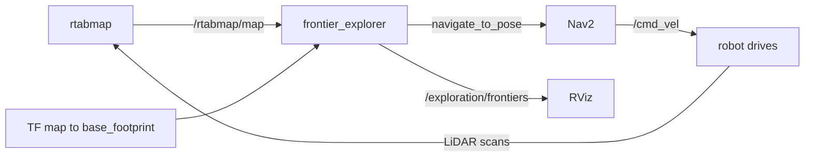

# Autonomous exploration

With `explore:=true` the robot maps the warehouse by itself: it drives to the
edge of what RTAB-Map has mapped so far, the map grows, and it repeats until no
reachable unknown space is left. No goal has to be clicked.

```bash
ros2 launch wsl_sim warehouse.launch.py nav:=true explore:=true
```

`explore:=true` requires `nav:=true` (and `slam:=true`, the default). The launch
stops before starting anything and says why if either is missing. The explorer
can also run next to a running system:

```bash
ros2 launch wsl_exploration exploration.launch.py [params_file:=my_exploration.yaml]
```

## How it works



The node (`wsl_exploration/frontier_explorer.py`) ticks once a second:

1. **Find frontiers.** A frontier cell is a free cell next to an unknown cell in
   `/rtabmap/map`. Cells closer than `clearance` to an obstacle are dropped (the
   robot cannot stand there), and clusters shorter than `min_frontier_length`
   are dropped (LiDAR speckle at wall edges).
2. **Choose one.** Cost = distance to the robot − `length_weight` × frontier
   length: near and long frontiers first.
3. **Go.** One `NavigateToPose` goal, facing the frontier so the LiDAR and the
   camera look into the unknown space.
4. **Supervise.** The goal is cancelled when its frontier has been explored on
   the way, or after `goal_timeout`.
5. **Remember.** Reached and failed goals are blacklisted within
   `blacklist_radius`, so the robot never loops on a frontier it cannot clear.
6. **Finish.** After `no_frontier_patience` ticks without a frontier it reports
   completion and, with `return_to_start: true`, drives back to the spawn pose.

The frontier detection is in `frontier_utils.py`, pure numpy without ROS
imports, with unit tests in `test/test_frontier_utils.py`.

## RViz

The display **Exploration frontiers** shows the frontier cells (green), the
current goal (red arrow) and blacklisted goals (grey spheres). The map itself
grows in **Occupancy (RTAB-Map)**.

## Parameters

See [`config/exploration.yaml`](../src/wsl_exploration/config/exploration.yaml);
every parameter is documented there. The ones to tune first:

| Parameter | Default | Effect |
|---|---|---|
| `clearance` | 0.4 m | Larger keeps goals further from racks; at least the robot half-width plus the 0.05 m footprint padding. |
| `min_frontier_length` | 0.5 m | Smaller also explores narrow gaps; larger skips them. |
| `blacklist_radius` | 0.7 m | Larger skips more neighbouring goals after a failure. |
| `return_to_start` | true | Drive back to the spawn pose when done. |

## Limits

- It explores what Nav2 can reach: openings narrower than the robot plus its
  inflation (0.9 m passages are the narrowest known to work) are blacklisted
  after Nav2 aborts.
- Glass or other surfaces the LiDAR passes through leave permanent frontiers;
  they are blacklisted once visited.
- Exploration is greedy (nearest first), not a minimum-time tour.
- Not yet measured in the full Gazebo simulation. The frontier logic is covered
  by unit tests and a closed-loop check on a synthetic map; the ROS node is
  checked only by a syntax check.
